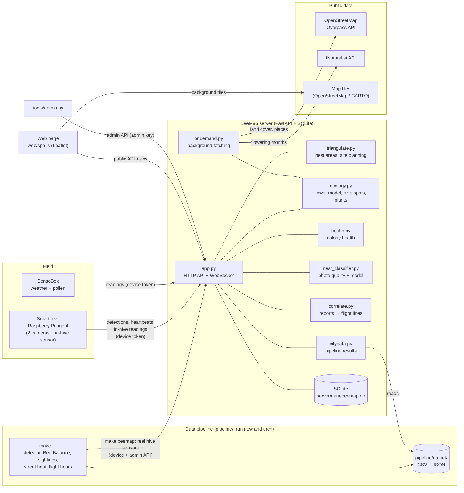
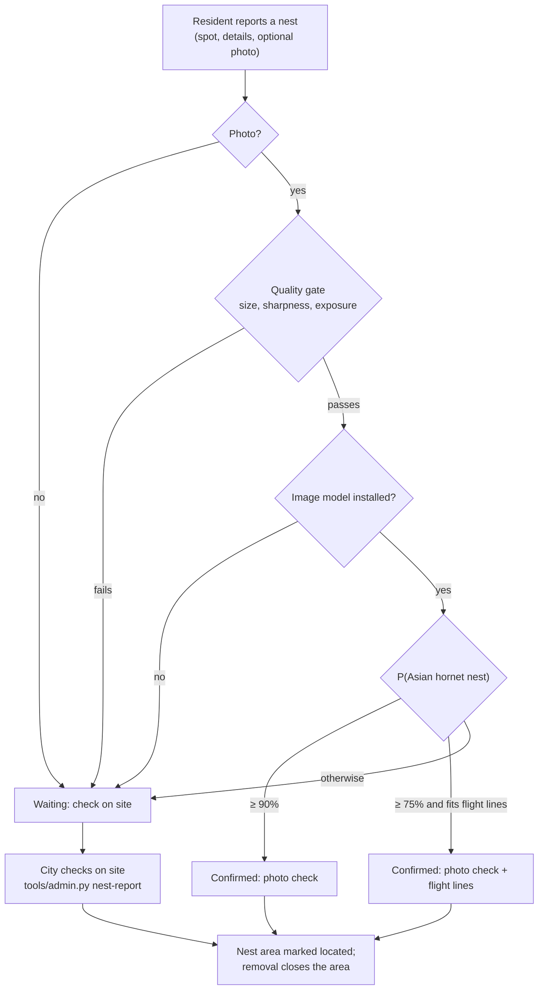

# Architecture

BeeMap has five parts: devices in the field, one Python server, one web page, a command-line admin tool, and an offline data pipeline. External public data is fetched by the server when it's needed; the pipeline's heavier analysis runs separately, now and then, and leaves result files the server reads.



## Components

### Smart hive (Raspberry Pi agent): `pi/beemap_agent.py`

- **Detection camera** at the entrance or bait station runs the VespAI YOLOv5 model and tracks each Asian hornet; a track ending means the hornet left.
- **Heading camera** (external, sky-facing fisheye or outward-looking) tracks moving blobs. The heading track that starts within 3 s of the hornet leaving gives its flight direction. No AI is needed on this camera.
- **Colony monitor**: in-hive temperature and humidity (BME280, SHT31 or DHT22), and entrance activity counted as moving blobs in a configurable entrance area.
- **Uploads** go to the server with a per-hive **device token**: detections (with snapshot), a heartbeat every minute, and in-hive readings every 5 minutes. Uploads queue on the SD card when offline.
- A **single-camera fallback** (exit direction on the detection camera) and a `--simulate` mode exist.

See [hardware.md](hardware.md).

### SensoBox

A separate sensor box (pressure, humidity, light/UV, temperature; pollen planned). It posts readings to the server with its own device token. A box can be linked to a smart hive to give that hive's outside weather.

### Server: `server/`

One FastAPI process with SQLite. It's stateless apart from the database, a few cached JSON files and photos.

| Module | Role |
|---|---|
| `app.py` | HTTP API, WebSocket hub, authentication, database schema, public views, orchestration |
| `triangulate.py` | Nest-area estimation from flight bearings; smart-hive site planning |
| `ecology.py` | 50 m raster of the city: flower supply per month, SensoBox fusion, hive spot check, safe-area and gap grids, plant planner |
| `health.py` | Colony-health indicators from in-hive data versus weather |
| `nest_classifier.py` | Photo quality gate and pluggable ONNX image model for nest photos |
| `correlate.py` | Matches nest reports to nest areas and direction-only corridors |
| `ondemand.py` | Background fetching of OpenStreetMap and iNaturalist data, with caching and retries |
| `osm_import.py`, `bloom_import.py` | Download and conversion code for those sources |
| `geodata.py` | Demo map data and the loader that switches to OpenStreetMap data |
| `citydata.py` | Reads the data pipeline's result files for `/api/city/*`, standard library only; re-reads a file when it changes |

The algorithms are described in [algorithms.md](algorithms.md).

### Data pipeline: `pipeline/`

A separate Python 3.11 project, driven by a Makefile, with heavier dependencies than the server (pandas, scipy, ultralytics). It downloads the hive camera recordings, BeeHappy hive sensors, senseBox stations, summer-school heat walks, OpenStreetMap land use (OpenFreeMap tiles) and GBIF sightings. It then trains a bee detector and writes small CSV and JSON files to `pipeline/output/`.

- **It runs offline and only now and then,** when new data arrives. The results are committed, so the server works without it.
- **The server reads those files;** it never imports pipeline code. A missing file just means that layer isn't available.
- **`make beemap`** is the one step that talks to the server: it sends the real hive sensors and the hive weather station through the normal upload API, like a device would.

See [pipeline.md](pipeline.md).

### Web page: `web/`

A single page with no build step: `index.html`, `spa.js` and `spa.css`, plus Leaflet bundled locally in `web/vendor/`.

- **Map first:** a search box, a panel with tabs (Overview, Hornets, Flowers, Hives, Sensors), a layers popover in which each layer has its own filters, and a **place card** for any clicked spot.
- **City data from the pipeline:** the Bee Balance, Public sightings (GBIF) and Street heat layers; Bee Balance, sightings, flight-hours, street-heat and hive-camera cards on the tabs; Bee Balance and street heat in the place card. Each appears only when its data exists.
- **Read-only**, apart from two anonymous contributions: *I planted something* and *Report a nest*.
- **Live updates** over `/ws`, with a 2-minute polling fallback.
- **The view is in the URL** (map position, layers, tab, month, clicked spot, background map), so any view can be shared as a link.
- **Background map:** OpenStreetMap tiles by default, with automatic fallback to the next provider if tiles fail.

### Admin tool: `tools/admin.py`

City operations happen on the server, not on the website: confirming alerts and nest reports, nest status, stations, SensoBoxes, colony health, and switching reports on or off. It authenticates with the admin key the server generates on first start. See [operations.md](operations.md).

## Main data flows

### Hornet to nest area

```mermaid
sequenceDiagram
  participant D as Detection camera (VespAI)
  participant H as Heading camera
  participant P as Pi agent
  participant S as Server
  participant W as Web page
  D->>P: hornet tracked, then leaves
  H->>P: motion track starting at that moment
  P->>P: pair the two; direction relative to the heading camera
  P->>S: POST /api/stations/{id}/detections (snapshot, heading, uncertainty)
  S->>S: bearing = camera heading + relative heading
  S->>S: recompute nest areas (coalesced): lines → crossings → nest ellipses
  S-->>W: WebSocket "detection", "nests", "lines"
  W->>W: redraw alerts, flight lines, nest areas
```

### Nest report to confirmation



### Flower supply

Land cover (OpenStreetMap, or demo shapes) gives a monthly bloom profile on a 50 m raster. Residents' plantings are added on top. The supply within 800 m of every cell comes from an FFT convolution. SensoBox pollen corrects it near each box. The result drives flower gaps, the plant planner and the hive spot check.

## Live updates and recomputation

- The server keeps the WebSocket clients in a hub and broadcasts typed events: `detection`, `station`, `station_deleted`, `nests`, `lines`, `planning_changed`, `eco_changed`, `nest_reports`, `settings` and `health_changed`.
- **Nest areas** are recomputed after new bearings. Bursts are coalesced: at most one run in flight and one queued.
- **The flower model** is rebuilt from scratch when map data arrives, new plantings come in or SensoBox pollen data changes. It's swapped in as a whole, so requests never see a half-built model.
- **SensoBox recomputation** is coalesced to at most one every few seconds.
- **The web page** debounces refreshes and reloads only what changed.

## Storage

| Where | What |
|---|---|
| `server/data/beemap.db` | SQLite: `stations`, `detections`, `nests`, `nest_reports`, `apiaries`, `plantings`, `sensoboxes`, `sensor_readings`, `hive_readings` (with an optional `hive` colony name, added to older databases on start), `settings` (and an unused leftover `hive_requests` table) |
| `server/data/images/` | Detection snapshots, served publicly at `/images` |
| `server/data/reports/` | Nest-report photos, **private** |
| `server/data/live/` | Latest heartbeat frame per hive, **private** |
| `server/data/admin_key.txt` | Generated admin key |
| `server/osm_data.json` | Cached OpenStreetMap land cover (refreshed after 30 days) |
| `server/bloom_data.json` | Cached iNaturalist bloom months (each plant re-checked after 90 days) |
| `server/models/nest_classifier.onnx` | Optional nest-photo model (not included) |
| `pipeline/output/` | Data pipeline results read by the server (committed; rewritten by `make`) |

`BEEMAP_DATA` moves the data folder; `BEEMAP_PIPELINE_OUT` points the server at another pipeline output folder.

## Trust boundaries

| Caller | Authentication | Can do |
|---|---|---|
| Anyone (web page) | none | Read the public API; add plantings; report nests (both rate-limited) |
| Pi / SensoBox | device token per station or box | Upload its own data only |
| City staff | admin key (`tools/admin.py`) | Everything else |

See [privacy-security.md](privacy-security.md).
